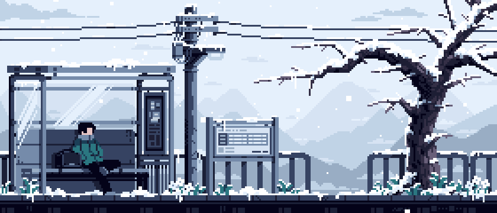

<table style="border-collapse: collapse; border: none;">
<tr>
<td valign="top">

##### <!--START_HEADER-->🌑 03:52 AM, ☁️ Broken Clouds, 🌡 14°C<!--END_START_HEADER-->

<!--START_MOOD-->🤔 Hmm, I am probably debugging, hacking<!--END_MOOD-->  
<!--START_COFFEE-->☕: ████░░░░░░ 40%<!--END_COFFEE--> 
<!--START_CODE-->💻: █████░░░░░ 50%<!--END_CODE-->  
<!--START_TIP-->💡 Night owl mode: Comment your code for tomorrow’s you 🌙<!--END_TIP-->  

</td>
<td valign="top">

</td>
</tr>
</table>
